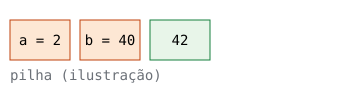

# Trunade! — aula de teste

Cada bloco `cpp` tem um botão ▶ (ou **Shift+Enter** dentro do código).
Edite à vontade no navegador: o arquivo `.md` não é alterado.

## Saída simples

```cpp
#include <iostream>

int main() {
    std::cout << "Olá, Trunade!\n";
}
```

## Erro de compilação

```cpp
int main() {
    return x;
}
```

## Código de saída e stderr

```cpp
#include <iostream>

int main() {
    std::cerr << "algo deu errado\n";
    return 3;
}
```

## Segfault

```cpp
int main() {
    volatile int* p = nullptr;
    return *p;
}
```

## Entrada fixa (bloco `stdin`)

```cpp {flags="-O2"}
#include <iostream>

int main() {
    int a, b;
    std::cin >> a >> b;
    std::cout << a << " + " << b << " = " << a + b << "\n";
}
```

```stdin
2 40
```



## Entrada interativa

Sem bloco `stdin`, o programa roda num terminal: digite na saída.

```cpp
#include <iostream>
#include <string>

int main() {
    std::string nome;
    std::cout << "Seu nome: " << std::flush;
    std::getline(std::cin, nome);
    std::cout << "Olá, " << nome << "!\n";
}
```

## Laço infinito com tempo limite

Com entrada fixa vale o tempo limite (aqui, 2 s). No terminal interativo, use ■.

```cpp {timeout=2}
int main() {
    for (;;) {}
}
```

```stdin
```

## Python também

```python
for i in range(3):
    print("linha", i)
```

## HTML embutido

<iframe src="widget.html" height="70" width="300"></iframe>
