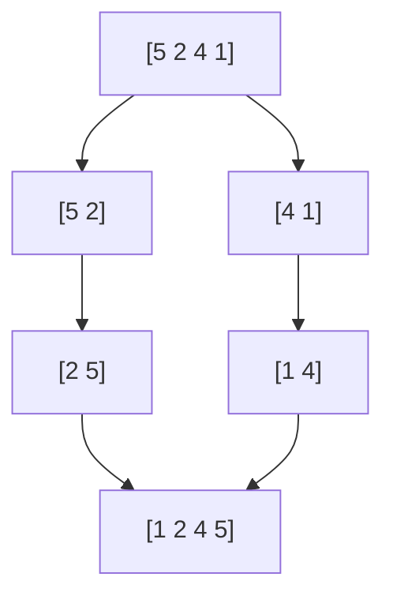
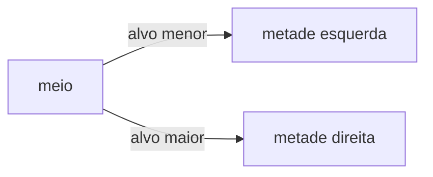

# Exemplos

Receitas para copiar e colar. Cada uma mostra o Markdown e, embaixo, a página do Trunade! com a execução de verdade (`g++-16`). A [sintaxe](/docs/sintaxe/) explica cada peça.

## Um problema de maratona

O molde esconde o cabeçalho; os casos fazem o papel do juiz. O primeiro caso é o do enunciado e o segundo é o caso extremo.

````markdown preview=ex-maratona
```cpp template=maratona
#include <bits/stdc++.h>
using namespace std;
//{code}
```

## Soma do vetor

```cpp-maratona
int main() {
    int n;
    cin >> n;
    long long soma = 0;
    for (int i = 0; i < n; i++) {
        long long x;
        cin >> x;
        soma += x;
    }
    cout << soma << '\n';
}
```

```stdin
3
1 2 3
```

```expected
6
```

```stdin
2
2000000000 2000000000
```

```expected
4000000000
```
````

Os dois casos dão ✓.

## Passou no exemplo, falhou no teste

O mesmo problema com `int`. É a cena que todo aluno precisa ver uma vez:

````markdown preview=ex-overflow
```cpp
#include <iostream>
int main() {
    int n, soma = 0;
    std::cin >> n;
    for (int i = 0; i < n; i++) {
        int x;
        std::cin >> x;
        soma += x;
    }
    std::cout << soma << '\n';
}
```

```stdin
3
1 2 3
```

```expected
6
```

```stdin
2
2000000000 2000000000
```

```expected
4000000000
```
````

O caso 1 dá ✓; o caso 2 dá ✗, com a linha que divergiu.

## Vários testes por entrada

Quando o problema começa com `t` testes, ponha o `main` no molde e deixe na tela só o `solve()`:

````markdown preview=ex-testes
```cpp template=testes
#include <bits/stdc++.h>
using namespace std;

//{code}

int main() {
    int t;
    cin >> t;
    while (t--) solve();
}
```

```cpp-testes
void solve() {
    long long a, b;
    cin >> a >> b;
    cout << gcd(a, b) << '\n';
}
```

```stdin
3
12 18
7 5
0 9
```

```expected
6
1
9
```
````

O bloco mostra "3 linhas do molde acima" e "6 linhas do molde abaixo", e a numeração do editor começa na linha 4. Blocos sem `-testes` continuam completos.

## O erro também é conteúdo

Cada bloco abaixo leva um `stdin` vazio: assim roda com tempo limite e sem esperar ninguém digitar.

**Erro de compilação**: a saída do compilador aparece inteira e colorida.

````markdown preview=ex-compilacao
```cpp
#include <iostream>
int main() {
    int x = 10
    std::cout << x << "\n";
}
```

```stdin
```
````


**Acesso a ponteiro nulo**: o sinal aparece com o nome.

````markdown preview=ex-segfault
```cpp
int main() {
    int* p = nullptr;
    return *p;
}
```

```stdin
```
````


**Laço infinito**: com `timeout`, a aula não trava.

````markdown preview=ex-timeout
```cpp {timeout=1}
int main() {
    while (true) {}
}
```

```stdin
```
````


## Achar o bug com uma flag

`-D_GLIBCXX_DEBUG` liga as verificações da biblioteca padrão. O acesso fora do vetor, que antes passava calado, vira um erro com explicação:

````markdown preview=ex-debug-vetor
```cpp {flags="-D_GLIBCXX_DEBUG"}
#include <iostream>
#include <vector>
int main() {
    std::vector<int> v = {10, 20, 30};
    for (int i = 0; i <= 3; i++) std::cout << v[i] << "\n";
}
```

```stdin
```
````


Outra flag útil é `-DDEBUG`, para ligar trechos de depuração com `#ifdef DEBUG`:

````markdown preview=ex-debug-flag
```cpp {flags="-DDEBUG -O2"}
#include <iostream>
int main() {
#ifdef DEBUG
    std::cout << "modo debug\n";
#endif
    std::cout << "pronto\n";
}
```

```expected
modo debug
pronto
```
````

## Programa interativo

Sem `stdin`, a turma joga no próprio terminal da página:

````markdown preview=ex-jogo input="10|50|42"
```cpp
#include <iostream>
int main() {
    int segredo = 42, palpite = 0, tentativas = 0;
    while (palpite != segredo) {
        std::cout << "Palpite: ";
        std::cin >> palpite;
        tentativas++;
        if (palpite < segredo) std::cout << "maior\n";
        else if (palpite > segredo) std::cout << "menor\n";
    }
    std::cout << "Acertou em " << tentativas << " tentativas!\n";
}
```
````


## Python, com leitura rápida

````markdown preview=ex-python
```python template=io
import sys
input = sys.stdin.readline
# {code}
```

```python-io
n = int(input())
print(sum(map(int, input().split())) // n)
```

```stdin
4
2 4 6 8
```

```expected
5
```
````

## Exercício em passos, com pergunta

O enunciado primeiro, depois uma pergunta para a turma pensar e, no fim, a solução que roda:

~~~markdown preview=ex-passos
<!-- step: Enunciado -->
Dados $n$ números, imprima quantos são pares.

<!-- step: Pense -->
```quiz
Qual operação diz se `x` é par?
- [x] `x % 2 == 0`
- [ ] `x / 2 == 0`
- [x] `(x & 1) == 0`
```

<!-- step: Solução -->
```cpp
#include <iostream>
int main() {
    int n, pares = 0;
    std::cin >> n;
    for (int i = 0; i < n; i++) {
        int x;
        std::cin >> x;
        if (x % 2 == 0) pares++;
    }
    std::cout << pares << "\n";
}
```

```stdin
5
1 2 3 4 6
```

```expected
3
```
<!-- /steps -->
~~~

## Teoria com fórmula e diagrama

````markdown preview=ex-teoria
## Merge sort

Cada nível da recursão faz $O(n)$ trabalho, e há $\log_2 n$ níveis:

$$
T(n) = 2\,T\!\left(\frac{n}{2}\right) + O(n) = O(n \log n)
$$



> [!TIP] Na prova
> `sort` da biblioteca padrão já é $O(n \log n)$. Escreva o seu só para aprender.
````

## Esqueleto de uma aula

Um ponto de partida com tudo no lugar:

~~~markdown preview=ex-esqueleto
# Aula 7 · Busca binária

```cpp template=busca
#include <bits/stdc++.h>
using namespace std;
//{code}
```

## Motivação

Procurar um número num vetor **ordenado** de $10^6$ elementos.

```quiz
Quantas comparações, no pior caso, a busca linear faz?
- [x] $10^6$
- [ ] $20$
- [ ] $\log_2 10^6$
```

## A ideia



## Implementação

```cpp-busca
int main() {
    vector<int> v = {1, 3, 5, 7, 9, 11};
    int alvo;
    cin >> alvo;
    cout << binary_search(v.begin(), v.end(), alvo) << '\n';
}
```

```stdin
7
```

```expected
1
```

```stdin
4
```

```expected
0
```

## Exercício

<!-- step: Enunciado -->
Imprima a posição do primeiro elemento $\ge x$.

<!-- step: Solução -->
```cpp-busca
int main() {
    vector<int> v = {1, 3, 5, 7, 9, 11};
    int x;
    cin >> x;
    cout << lower_bound(v.begin(), v.end(), x) - v.begin() << '\n';
}
```

```stdin
6
```

```expected
3
```
<!-- /steps -->
~~~

Antes da aula, aperte <kbd>R</kbd> para rodar todos os blocos e confirmar que nada quebrou. Depois, exporte o PDF ou o HTML pelo ☰.
