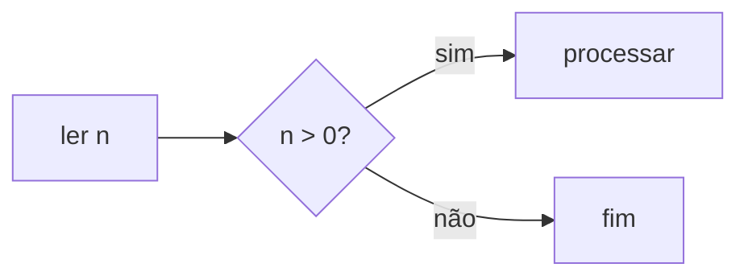

# Recursos de aula

Tudo aqui é Markdown e funciona sem internet. A referência completa, com cada regra, está em [Sintaxe](/docs/sintaxe/); aulas inteiras, em [Exemplos](/docs/exemplos/).

## Fórmulas

`$x^2$` no meio do texto. Em destaque, `$$ … $$` ou um bloco `math`:

````markdown preview=rec-formulas
A busca binária faz $\lceil \log_2 n \rceil$ comparações.

```math
T(n) = T(n/2) + O(1)
```
````

## Diagramas

Blocos `mermaid` viram diagramas e acompanham o tema da página.

````markdown preview=rec-diagrama

````

## Perguntas

Um bloco `quiz`: a primeira parte é o enunciado e a lista são as opções. `- [x]` marca as certas; mais de uma vira múltipla escolha.

````markdown preview=rec-quiz reveal
```quiz
Qual a complexidade da busca binária?
- [ ] O(n)
- [x] O(log n)
- [ ] O(n log n)
```
````

A turma escolhe; você revela quando quiser. Ao revelar, as corretas aparecem marcadas.

## Exercício em passos

Marcadores em comentário dividem um trecho em passos, com Anterior e Próximo. O código dentro dos passos continua rodando.

~~~markdown preview=rec-passos
<!-- step: Enunciado -->
Leia dois inteiros e imprima a soma.

<!-- step: Dica -->
Use `std::cin >> a >> b`.

<!-- step: Solução -->
```cpp
#include <iostream>
int main() { int a, b; std::cin >> a >> b; std::cout << a + b << "\n"; }
```
<!-- /steps -->
~~~

Sem `<!-- /steps -->`, os passos vão até o fim do arquivo.

## HTML, imagens e páginas

`<div>`, `` e `<iframe>` são aceitos. Arquivos ao lado do `.md` (imagens, páginas HTML) são servidos pelo próprio Trunade!.

- **Páginas locais** num iframe se ajustam à largura do texto e à altura do conteúdo, sem barras de rolagem.
- **Sites externos** mais largos que o texto: diga a largura que eles precisam e o Trunade! reduz para caber.

```html
<iframe src="https://visualgo.net/en/sorting" data-width="1200" height="640"></iframe>
```

> Sites externos precisam de internet e precisam aceitar ser embutidos. Teste antes da aula.
