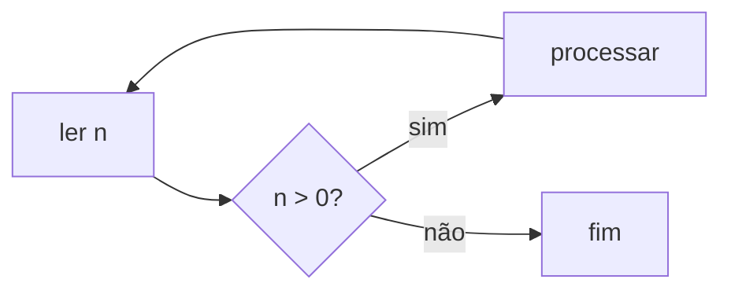
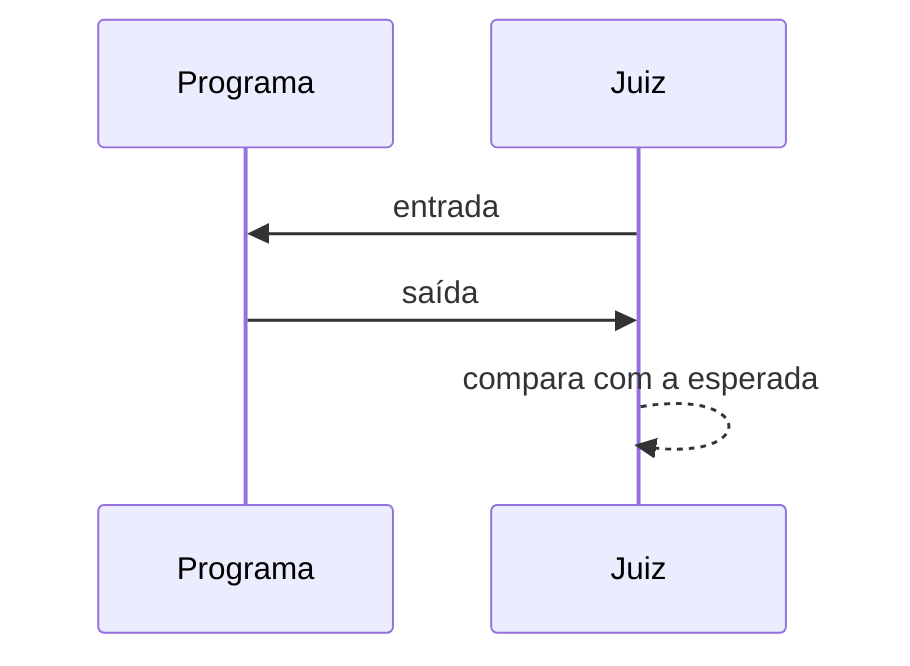

# Sintaxe

A aula é Markdown comum (CommonMark com as extensões do GitHub). O Trunade! dá significado a alguns blocos cercados (*fences*) e a dois comentários HTML. Todo o resto é texto.

## Resumo

| Escreva | Vira |
|---|---|
| ```` ```cpp ```` | bloco executável (qualquer linguagem configurada) |
| ```` ```cpp {flags="-O2" timeout=5} ```` | bloco com flags extras e tempo limite próprio |
| ```` ```cpp template ```` | molde escondido em volta dos próximos blocos |
| ```` ```stdin ```` | entrada fixa do bloco acima (um caso de teste) |
| ```` ```expected ```` | saída esperada do caso acima, com veredito ✓/✗ |
| ```` ```quiz ```` | pergunta de múltipla escolha |
| `<!-- step: Título -->` … `<!-- /steps -->` | exercício em passos |
| `$x$`, `$$x$$`, ```` ```math ```` | fórmula (KaTeX) |
| ```` ```mermaid ```` | diagrama |
| `> [!NOTE]`, `> [!TIP]`… | caixa de destaque |
| ``, `<iframe>`, `<div>`… | HTML, como está |

Qualquer outro fence (```` ```text ````, ```` ```bash ````, ```` ```json ````) continua sendo só código colorido, sem ▶.

## Blocos executáveis

Um fence cuja linguagem está configurada vira uma caixa editável com ▶. Cada bloco é um **programa completo**, compilado do zero; nada passa de um bloco para outro.

````markdown
```cpp
#include <iostream>
int main() {
    std::cout << "Olá, turma!\n";
}
```
````

| Linguagem | Nomes aceitos no fence |
|---|---|
| C++ | `cpp`, `c++`, `cxx`, `cc` |
| C | `c` |
| Python | `python`, `py`, `python3` |

Outras linguagens entram pela [configuração](/docs/configuracao/). Maiúsculas não importam: `C++` e `c++` são o mesmo.

## Atributos

Entre chaves, depois da linguagem. Só existem dois.

| Atributo | Exemplo | Efeito |
|---|---|---|
| `flags` | `flags="-O2 -DDEBUG"` | flags somadas às da configuração, separadas por espaço |
| `timeout` | `timeout=1.5` | tempo limite em segundos (só vale com entrada fixa) |

````markdown
```cpp {flags="-DDEBUG -O2" timeout=2}
#include <iostream>
int main() {
#ifdef DEBUG
    std::cout << "modo debug\n";
#endif
    std::cout << "pronto\n";
}
```
````

Aspas são necessárias quando o valor tem espaço. As flags aparecem na barra do bloco.

## Molde

O molde é o código que se repete (cabeçalhos, `using namespace std`, leitura rápida, um `main` fixo). Ele é declarado uma vez, fica escondido e o compilador o recebe em volta de cada bloco. A linha `{code}` marca onde o bloco entra:

````markdown
```cpp template
#include <bits/stdc++.h>
using namespace std;
//{code}
```

```cpp
int main() {
    cout << gcd(12, 18) << '\n';
}
```
````

Regras:

- O marcador é uma linha só com `{code}`, que pode vir atrás de um comentário da linguagem: `//{code}`, `// {code}`, `# {code}`.
- Sem marcador, o molde inteiro vai **antes** do bloco.
- Vale para os blocos seguintes **da mesma linguagem**, incluindo apelidos (um molde `cpp` vale para ```` ```c++ ````). Moldes de linguagens diferentes convivem.
- Um novo molde da mesma linguagem substitui o anterior. Um molde vazio desliga:

  ````markdown
  ```cpp template
  ```
  ````

- O molde não aparece como bloco. Cada bloco mostra uma faixa discreta, **"2 linhas do molde acima"**, que abre o trecho esmaecido e só para leitura.
- A numeração das linhas é a do programa inteiro, então `main.cpp:4:5: error` aponta a linha 4 que você vê.

### Molde com código depois

O que vem depois de `{code}` também é compilado. Assim, o bloco pode ter só a função que importa:

````markdown
```cpp template
#include <bits/stdc++.h>
using namespace std;

//{code}

int main() {
    int t;
    cin >> t;
    while (t--) solve();
}
```

```cpp
void solve() {
    long long a, b;
    cin >> a >> b;
    cout << gcd(a, b) << '\n';
}
```
````

### Molde em Python

````markdown
```python template
import sys
input = sys.stdin.readline
# {code}
```
````

## Entrada e casos de teste

Blocos `stdin` e `expected` logo **depois** de um bloco executável, separados dele só por linhas em branco, são os casos de teste dele. Com qualquer texto no meio, viram blocos comuns.

### Entrada fixa

````markdown
```stdin
3
1 2 3
```
````

Com entrada fixa, o programa roda em *pipes*: stdout e stderr aparecem separados (stderr em vermelho) e vale o tempo limite. Um `stdin` vazio roda sem entrada e com tempo limite.

### Saída esperada

````markdown
```stdin
3
1 2 3
```

```expected
6
```
````

Depois de rodar, o caso ganha ✓ ou ✗. No ✗, o terminal diz onde a saída diverge, como um juiz: `✗ resposta errada na linha 1: esperado «4000000000», saiu «-294967296»`.

A comparação:

- ignora espaços no fim das linhas e linhas em branco no fim da saída;
- considera espaços no começo das linhas e qualquer outra diferença;
- só compara se o programa terminou com código 0. Erro de execução, sinal ou tempo limite já dão ✗.

### Vários casos

Cada `stdin` abre um caso; o `expected` seguinte completa esse caso. O programa é compilado **uma vez** e roda em cada caso, na ordem:

````markdown
```stdin
3
1 2 3
```

```expected
6
```

```stdin
2
2000000000 2000000000
```

```expected
4000000000
```
````

| Sequência depois do bloco | Casos |
|---|---|
| `stdin` | 1 caso, sem veredito |
| `stdin`, `expected` | 1 caso com veredito |
| `expected` | 1 caso com entrada vazia, com veredito |
| `stdin`, `stdin` | 2 casos sem veredito |
| `stdin`, `expected`, `stdin` | 2 casos: o primeiro com veredito, o segundo sem |

### Interativo

Sem nenhum `stdin` ou `expected`, o programa roda num terminal de verdade: quem estiver no teclado digita no próprio terminal da página. Nesse modo não há tempo limite (use ■ para parar) e stdout e stderr vêm misturados, como num terminal.

## Perguntas

````markdown
```quiz
Qual a complexidade da busca binária num vetor de $n$ elementos?
- [ ] $O(n)$
- [x] $O(\log n)$
- [ ] $O(n \log n)$
```
````

- Tudo antes da lista é o enunciado, em Markdown (fórmulas e `código` valem).
- `- [x]` marca as corretas, `- [ ]` as erradas.
- Uma correta: escolha única. Mais de uma: múltipla escolha.

````markdown
```quiz
Quais estruturas dão acesso ao menor elemento em $O(1)$?
- [x] `priority_queue` com `greater<>`
- [x] `set` (com `begin()`)
- [ ] `vector` não ordenado
- [ ] `unordered_set`
```
````

As respostas ficam ocultas até alguém clicar em **Ver resposta**.

## Exercício em passos

Dois comentários HTML dividem um trecho em passos, com Anterior e Próximo:

~~~markdown
<!-- step: Enunciado -->
Leia $n$ e imprima a soma de $1$ a $n$.

<!-- step: Dica -->
Existe uma fórmula fechada: $\frac{n(n+1)}{2}$.

<!-- step: Solução -->
```cpp
#include <iostream>
int main() {
    long long n;
    std::cin >> n;
    std::cout << n * (n + 1) / 2 << "\n";
}
```

```stdin
100
```

```expected
5050
```
<!-- /steps -->
~~~

- `<!-- step: Título -->` abre um passo; o título aparece na trilha do topo.
- `<!-- /steps -->` fecha o exercício. Sem ele, os passos vão até o fim do arquivo.
- Dentro dos passos vale tudo: blocos executáveis, casos, perguntas, fórmulas.

## Fórmulas

KaTeX, desenhado localmente:

````markdown
A busca binária faz $\lceil \log_2 n \rceil$ comparações.

$$
\sum_{i=1}^{n} i = \frac{n(n+1)}{2}
$$

```math
T(n) = 2\,T(n/2) + O(n) \implies T(n) = O(n \log n)
```
````

## Diagramas

Mermaid, carregado só quando a aula tem diagrama e redesenhado ao trocar o tema:

````markdown

````

````markdown

````

## Caixas de destaque

````markdown
> [!NOTE]
> O `int` vai até 2 147 483 647.

> [!TIP] Dica de prova
> Na dúvida, `long long`.

> [!WARNING]
> `endl` esvazia o buffer a cada linha: em saídas grandes, use `'\n'`.

> [!CAUTION]
> Ler com `cin` sem `ios::sync_with_stdio(false)` pode estourar o tempo.
````

Tipos: `NOTE`, `TIP`, `IMPORTANT`, `WARNING`, `CAUTION`. O texto depois do tipo vira o título da caixa.

## Markdown do GitHub

Tabelas, ~~riscado~~, links automáticos, listas de tarefas e notas de rodapé:

````markdown
| Estrutura | Inserção | Menor |
|---|---|---|
| `set` | $O(\log n)$ | $O(1)$ |
| `vector` | $O(1)$ | $O(n)$ |

- [x] ler o enunciado
- [ ] testar o caso extremo

Veja a documentação[^ref].

[^ref]: https://en.cppreference.com
````

## HTML, imagens e páginas

HTML é aceito como está. Arquivos ao lado do `.md` são servidos pelo próprio Trunade!:

```html


<div style="display: grid; grid-template-columns: 1fr 1fr; gap: 1rem">
  <div>Antes</div>
  <div>Depois</div>
</div>
```

Iframes ocupam a largura do texto. Uma página **local** é reduzida para caber e a altura acompanha o conteúdo. Uma página **externa** mais larga que o texto precisa dizer a largura que usa, e o Trunade! a reduz:

```html
<iframe src="visualizacao.html"></iframe>
<iframe src="https://visualgo.net/en/sorting" data-width="1200" height="640"></iframe>
```

Veja os [exemplos](/docs/exemplos/) para aulas inteiras montadas com tudo isso.
