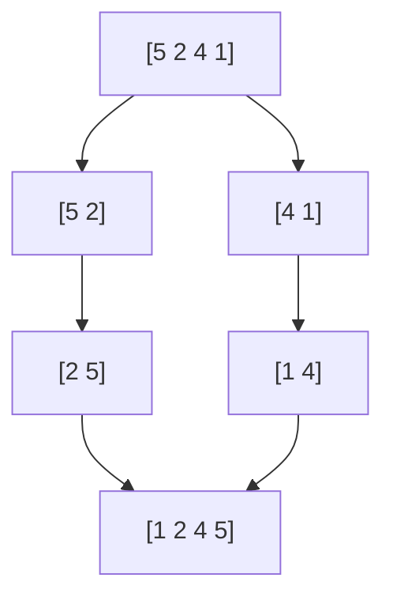
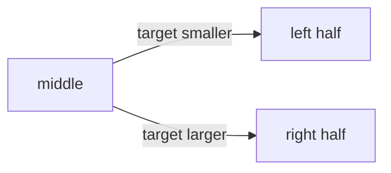

# Examples

Recipes to copy and paste. Each one shows the Markdown and, below it, the Trunade! page with the real run (`g++-16`). The [syntax](/en/docs/sintaxe/) page explains each piece.

## A contest problem

The template hides the header; the cases play the judge. The first case is the one from the statement and the second is the extreme case.

````markdown preview=ex-maratona
```cpp template=contest
#include <bits/stdc++.h>
using namespace std;
//{code}
```

## Sum of an array

```cpp-contest
int main() {
    int n;
    cin >> n;
    long long sum = 0;
    for (int i = 0; i < n; i++) {
        long long x;
        cin >> x;
        sum += x;
    }
    cout << sum << '\n';
}
```

```stdin
3
1 2 3
```

```expected
6
```

```stdin
2
2000000000 2000000000
```

```expected
4000000000
```
````

Both cases get ✓.

## Passed the sample, failed the test

The same problem with `int`. Every student needs to see this once:

````markdown preview=ex-overflow
```cpp
#include <iostream>
int main() {
    int n, sum = 0;
    std::cin >> n;
    for (int i = 0; i < n; i++) {
        int x;
        std::cin >> x;
        sum += x;
    }
    std::cout << sum << '\n';
}
```

```stdin
3
1 2 3
```

```expected
6
```

```stdin
2
2000000000 2000000000
```

```expected
4000000000
```
````

Case 1 gets ✓; case 2 gets ✗, with the line that differs.

## Several tests per input

When the problem starts with `t` tests, put `main` in the template and keep only `solve()` on screen:

````markdown preview=ex-testes
```cpp template=tests
#include <bits/stdc++.h>
using namespace std;

//{code}

int main() {
    int t;
    cin >> t;
    while (t--) solve();
}
```

```cpp-tests
void solve() {
    long long a, b;
    cin >> a >> b;
    cout << gcd(a, b) << '\n';
}
```

```stdin
3
12 18
7 5
0 9
```

```expected
6
1
9
```
````

The block shows "3 template lines above" and "6 template lines below", and the editor numbering starts at line 4. Blocks without `-tests` stay whole.

## Errors are content too

Each block below has an empty `stdin`: it then runs with a time limit and without waiting for anyone to type.

**Compile error**: the compiler output shows in full, in color.

````markdown preview=ex-compilacao
```cpp
#include <iostream>
int main() {
    int x = 10
    std::cout << x << "\n";
}
```

```stdin
```
````


**Null pointer access**: the signal shows by name.

````markdown preview=ex-segfault
```cpp
int main() {
    int* p = nullptr;
    return *p;
}
```

```stdin
```
````


**Infinite loop**: with `timeout`, the lesson does not hang.

````markdown preview=ex-timeout
```cpp {timeout=1}
int main() {
    while (true) {}
}
```

```stdin
```
````


## Finding the bug with a flag

`-D_GLIBCXX_DEBUG` turns on the standard library checks. The out-of-bounds access that used to pass silently becomes an explained error:

````markdown preview=ex-debug-vetor
```cpp {flags="-D_GLIBCXX_DEBUG"}
#include <iostream>
#include <vector>
int main() {
    std::vector<int> v = {10, 20, 30};
    for (int i = 0; i <= 3; i++) std::cout << v[i] << "\n";
}
```

```stdin
```
````


Another useful flag is `-DDEBUG`, to switch debugging code on with `#ifdef DEBUG`:

````markdown preview=ex-debug-flag
```cpp {flags="-DDEBUG -O2"}
#include <iostream>
int main() {
#ifdef DEBUG
    std::cout << "debug mode\n";
#endif
    std::cout << "done\n";
}
```

```expected
debug mode
done
```
````

## Interactive program

With no `stdin`, the class plays right in the page's terminal:

````markdown preview=ex-jogo input="10|50|42"
```cpp
#include <iostream>
int main() {
    int secret = 42, guess = 0, tries = 0;
    while (guess != secret) {
        std::cout << "Guess: ";
        std::cin >> guess;
        tries++;
        if (guess < secret) std::cout << "higher\n";
        else if (guess > secret) std::cout << "lower\n";
    }
    std::cout << "Got it in " << tries << " tries!\n";
}
```
````


## Python, with fast input

````markdown preview=ex-python
```python template=io
import sys
input = sys.stdin.readline
# {code}
```

```python-io
n = int(input())
print(sum(map(int, input().split())) // n)
```

```stdin
4
2 4 6 8
```

```expected
5
```
````

## Exercise in steps, with a question

The statement first, then a question for the class to think about, and finally the solution that runs:

~~~markdown preview=ex-passos
<!-- step: Statement -->
Given $n$ numbers, print how many are even.

<!-- step: Think -->
```quiz
Which expression tells whether `x` is even?
- [x] `x % 2 == 0`
- [ ] `x / 2 == 0`
- [x] `(x & 1) == 0`
```

<!-- step: Solution -->
```cpp
#include <iostream>
int main() {
    int n, even = 0;
    std::cin >> n;
    for (int i = 0; i < n; i++) {
        int x;
        std::cin >> x;
        if (x % 2 == 0) even++;
    }
    std::cout << even << "\n";
}
```

```stdin
5
1 2 3 4 6
```

```expected
3
```
<!-- /steps -->
~~~

## Theory with a formula and a diagram

````markdown preview=ex-teoria
## Merge sort

Each level of the recursion does $O(n)$ work, and there are $\log_2 n$ levels:

$$
T(n) = 2\,T\!\left(\frac{n}{2}\right) + O(n) = O(n \log n)
$$



> [!TIP] In a contest
> The standard library `sort` is already $O(n \log n)$. Write your own only to learn.
````

## Lesson skeleton

A starting point with everything in place:

~~~markdown preview=ex-esqueleto
# Lesson 7 · Binary search

```cpp template=search
#include <bits/stdc++.h>
using namespace std;
//{code}
```

## Motivation

Looking for a number in a **sorted** array of $10^6$ elements.

```quiz
How many comparisons does linear search make in the worst case?
- [x] $10^6$
- [ ] $20$
- [ ] $\log_2 10^6$
```

## The idea



## Implementation

```cpp-search
int main() {
    vector<int> v = {1, 3, 5, 7, 9, 11};
    int target;
    cin >> target;
    cout << binary_search(v.begin(), v.end(), target) << '\n';
}
```

```stdin
7
```

```expected
1
```

```stdin
4
```

```expected
0
```

## Exercise

<!-- step: Statement -->
Print the position of the first element $\ge x$.

<!-- step: Solution -->
```cpp-search
int main() {
    vector<int> v = {1, 3, 5, 7, 9, 11};
    int x;
    cin >> x;
    cout << lower_bound(v.begin(), v.end(), x) - v.begin() << '\n';
}
```

```stdin
6
```

```expected
3
```
<!-- /steps -->
~~~

Before class, press <kbd>R</kbd> to run every block and make sure nothing broke. Then export the PDF or the HTML from ☰.
