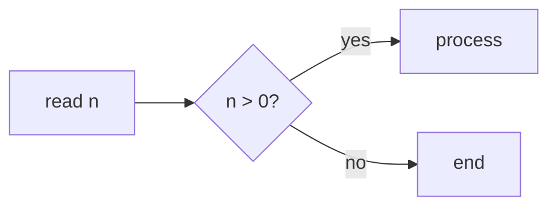

# Lesson features

All of this is Markdown and works offline. The full reference, with every rule, is in [Syntax](/en/docs/sintaxe/); whole lessons in [Examples](/en/docs/exemplos/).

## Math

`$x^2$` inline. For display math, `$$ … $$` or a `math` block:

````markdown preview=rec-formulas
Binary search makes $\lceil \log_2 n \rceil$ comparisons.

```math
T(n) = T(n/2) + O(1)
```
````

## Diagrams

`mermaid` blocks become diagrams and follow the page theme.

````markdown preview=rec-diagrama

````

## Questions

A `quiz` block: the first part is the question and the list holds the options. `- [x]` marks the right ones; more than one makes it multiple choice.

````markdown preview=rec-quiz reveal
```quiz
What is the complexity of binary search?
- [ ] O(n)
- [x] O(log n)
- [ ] O(n log n)
```
````

The class picks; you reveal when you want. On reveal, the right options show up checked.

## Step-by-step exercises

Comment markers split a passage into steps, with Back and Next. Code inside the steps still runs.

~~~markdown preview=rec-passos
<!-- step: Statement -->
Read two integers and print their sum.

<!-- step: Hint -->
Use `std::cin >> a >> b`.

<!-- step: Solution -->
```cpp
#include <iostream>
int main() { int a, b; std::cin >> a >> b; std::cout << a + b << "\n"; }
```
<!-- /steps -->
~~~

Without `<!-- /steps -->`, the steps run to the end of the file.

## HTML, images and pages

`<div>`, `` and `<iframe>` are allowed. Files next to the `.md` (images, HTML pages) are served by Trunade! itself.

- **Local pages** in an iframe fit the text width and the content height, with no scrollbars.
- **External sites** wider than the text: tell Trunade! the width they need and it scales them down to fit.

```html
<iframe src="https://visualgo.net/en/sorting" data-width="1200" height="640"></iframe>
```

> External sites need internet and must allow embedding. Test before class.
