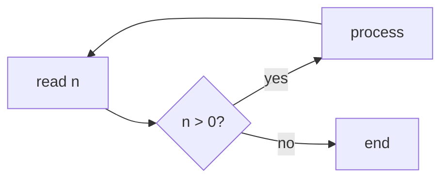
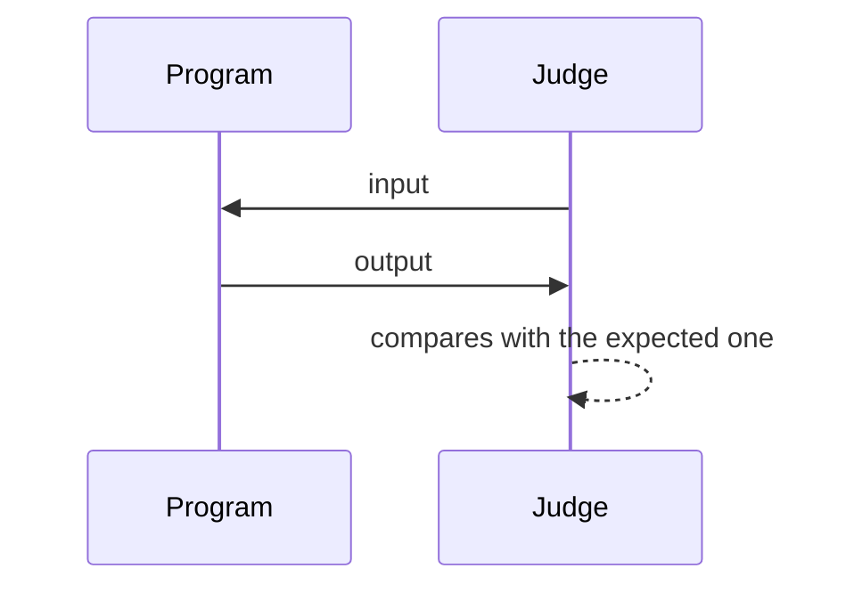

# Syntax

A lesson is plain Markdown (CommonMark with the GitHub extensions). Trunade! gives meaning to a few fenced blocks and two HTML comments. Everything else is text.

## Summary

| Write | Becomes |
|---|---|
| ```` ```cpp ```` | runnable block (any configured language) |
| ```` ```cpp {flags="-O2" timeout=5} ```` | block with extra flags and its own time limit |
| ```` ```cpp template ```` | hidden template around the following blocks |
| ```` ```stdin ```` | fixed input for the block above (one test case) |
| ```` ```expected ```` | expected output for the case above, with a ✓/✗ verdict |
| ```` ```quiz ```` | multiple choice question |
| `<!-- step: Title -->` … `<!-- /steps -->` | exercise in steps |
| `$x$`, `$$x$$`, ```` ```math ```` | formula (KaTeX) |
| ```` ```mermaid ```` | diagram |
| `> [!NOTE]`, `> [!TIP]`… | callout box |
| ``, `<iframe>`, `<div>`… | HTML, as is |

Any other fence (```` ```text ````, ```` ```bash ````, ```` ```json ````) stays highlighted code, with no ▶.

## Runnable blocks

A fence whose language is configured becomes an editable box with ▶. Each block is a **whole program**, compiled from scratch; nothing carries over from one block to the next.

````markdown
```cpp
#include <iostream>
int main() {
    std::cout << "Hello, class!\n";
}
```
````

| Language | Names accepted in the fence |
|---|---|
| C++ | `cpp`, `c++`, `cxx`, `cc` |
| C | `c` |
| Python | `python`, `py`, `python3` |

Other languages come in through the [configuration](/en/docs/configuracao/). Case does not matter: `C++` and `c++` are the same.

## Attributes

In braces, after the language. There are only two.

| Attribute | Example | Effect |
|---|---|---|
| `flags` | `flags="-O2 -DDEBUG"` | flags added to the configured ones, separated by spaces |
| `timeout` | `timeout=1.5` | time limit in seconds (only with fixed input) |

````markdown
```cpp {flags="-DDEBUG -O2" timeout=2}
#include <iostream>
int main() {
#ifdef DEBUG
    std::cout << "debug mode\n";
#endif
    std::cout << "done\n";
}
```
````

Quotes are needed when the value has spaces. The flags show in the block's bar.

## Template

The template is the code that repeats (headers, `using namespace std`, fast input, a fixed `main`). It is declared once, stays hidden, and the compiler gets it around each block. The `{code}` line marks where the block goes:

````markdown
```cpp template
#include <bits/stdc++.h>
using namespace std;
//{code}
```

```cpp
int main() {
    cout << gcd(12, 18) << '\n';
}
```
````

Rules:

- The marker is a line with only `{code}`, possibly behind a comment of the language: `//{code}`, `// {code}`, `# {code}`.
- Without a marker, the whole template goes **before** the block.
- It applies to the following blocks **of the same language**, aliases included (a `cpp` template applies to ```` ```c++ ````). Templates of different languages coexist.
- A new template of the same language replaces the previous one. An empty template turns it off:

  ````markdown
  ```cpp template
  ```
  ````

- The template does not show as a block. Each block shows a discreet strip, **"2 template lines above"**, that opens the hidden part dimmed and read-only.
- Line numbers are those of the whole program, so `main.cpp:4:5: error` points at the line 4 you see.

### Template with code after

What comes after `{code}` is compiled too. The block can then hold only the function that matters:

````markdown
```cpp template
#include <bits/stdc++.h>
using namespace std;

//{code}

int main() {
    int t;
    cin >> t;
    while (t--) solve();
}
```

```cpp
void solve() {
    long long a, b;
    cin >> a >> b;
    cout << gcd(a, b) << '\n';
}
```
````

### Template in Python

````markdown
```python template
import sys
input = sys.stdin.readline
# {code}
```
````

## Input and test cases

`stdin` and `expected` blocks right **after** a runnable block, separated from it only by blank lines, are its test cases. With any text in between, they become ordinary blocks.

### Fixed input

````markdown
```stdin
3
1 2 3
```
````

With fixed input the program runs on pipes: stdout and stderr show separately (stderr in red) and the time limit applies. An empty `stdin` runs with no input and with the time limit.

### Expected output

````markdown
```stdin
3
1 2 3
```

```expected
6
```
````

After running, the case gets ✓ or ✗. On ✗, the terminal says where the output differs, like a judge: `✗ wrong answer on line 1: expected «4000000000», got «-294967296»`.

The comparison:

- ignores trailing spaces on each line and trailing blank lines;
- counts leading spaces and any other difference;
- only compares when the program exited with code 0. A runtime error, signal or time limit is already ✗.

### Several cases

Each `stdin` opens a case; the following `expected` completes it. The program is compiled **once** and runs on each case, in order:

````markdown
```stdin
3
1 2 3
```

```expected
6
```

```stdin
2
2000000000 2000000000
```

```expected
4000000000
```
````

| Sequence after the block | Cases |
|---|---|
| `stdin` | 1 case, no verdict |
| `stdin`, `expected` | 1 case with a verdict |
| `expected` | 1 case with empty input, with a verdict |
| `stdin`, `stdin` | 2 cases, no verdict |
| `stdin`, `expected`, `stdin` | 2 cases: the first with a verdict, the second without |

### Interactive

With no `stdin` or `expected`, the program runs in a real terminal: whoever is at the keyboard types into the page's terminal. There is no time limit in this mode (use ■ to stop), and stdout and stderr come mixed, as in a terminal.

## Questions

````markdown
```quiz
What is the complexity of binary search on $n$ elements?
- [ ] $O(n)$
- [x] $O(\log n)$
- [ ] $O(n \log n)$
```
````

- Everything before the list is the question, in Markdown (math and `code` work).
- `- [x]` marks the right options, `- [ ]` the wrong ones.
- One right option: single choice. More than one: multiple choice.

````markdown
```quiz
Which structures give the smallest element in $O(1)$?
- [x] `priority_queue` with `greater<>`
- [x] `set` (with `begin()`)
- [ ] unsorted `vector`
- [ ] `unordered_set`
```
````

Answers stay hidden until someone clicks **Show answer**.

## Exercise in steps

Two HTML comments split a stretch into steps, with Back and Next:

~~~markdown
<!-- step: Statement -->
Read $n$ and print the sum from $1$ to $n$.

<!-- step: Hint -->
There is a closed formula: $\frac{n(n+1)}{2}$.

<!-- step: Solution -->
```cpp
#include <iostream>
int main() {
    long long n;
    std::cin >> n;
    std::cout << n * (n + 1) / 2 << "\n";
}
```

```stdin
100
```

```expected
5050
```
<!-- /steps -->
~~~

- `<!-- step: Title -->` opens a step; the title shows in the track at the top.
- `<!-- /steps -->` closes the exercise. Without it, the steps run to the end of the file.
- Anything works inside steps: runnable blocks, cases, questions, formulas.

## Formulas

KaTeX, drawn locally:

````markdown
Binary search makes $\lceil \log_2 n \rceil$ comparisons.

$$
\sum_{i=1}^{n} i = \frac{n(n+1)}{2}
$$

```math
T(n) = 2\,T(n/2) + O(n) \implies T(n) = O(n \log n)
```
````

## Diagrams

Mermaid, loaded only when the lesson has a diagram and redrawn when the theme changes:

````markdown

````

````markdown

````

## Callout boxes

````markdown
> [!NOTE]
> `int` goes up to 2 147 483 647.

> [!TIP] Contest tip
> When in doubt, `long long`.

> [!WARNING]
> `endl` flushes the buffer on every line: for large outputs, use `'\n'`.

> [!CAUTION]
> Reading with `cin` without `ios::sync_with_stdio(false)` may exceed the time limit.
````

Types: `NOTE`, `TIP`, `IMPORTANT`, `WARNING`, `CAUTION`. Text after the type becomes the box title.

## GitHub Markdown

Tables, ~~strikethrough~~, autolinks, task lists and footnotes:

````markdown
| Structure | Insert | Smallest |
|---|---|---|
| `set` | $O(\log n)$ | $O(1)$ |
| `vector` | $O(1)$ | $O(n)$ |

- [x] read the statement
- [ ] test the extreme case

See the documentation[^ref].

[^ref]: https://en.cppreference.com
````

## HTML, images and pages

HTML is accepted as is. Files next to the `.md` are served by Trunade! itself:

```html


<div style="display: grid; grid-template-columns: 1fr 1fr; gap: 1rem">
  <div>Before</div>
  <div>After</div>
</div>
```

Iframes take the text width. A **local** page is scaled down to fit and its height follows the content. An **external** page wider than the text must state the width it uses, and Trunade! scales it down:

```html
<iframe src="visualization.html"></iframe>
<iframe src="https://visualgo.net/en/sorting" data-width="1200" height="640"></iframe>
```

See the [examples](/en/docs/exemplos/) for whole lessons built with all of this.
